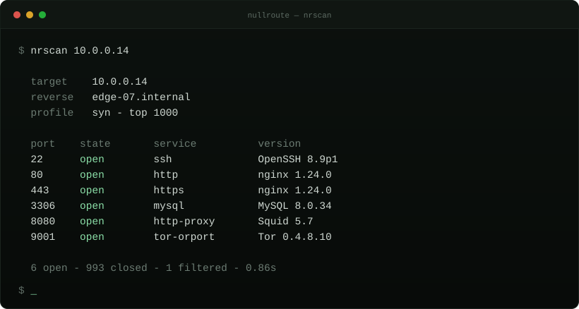

<div align="center">

# nullroute

ten small tools, one console




</div>

A small native toolkit for demos, film and teaching. Half of it is theatre,
half of it actually works on your own machine.

`nullroute.exe` is the whole application. It serves the console from inside the
binary on a loopback port, then opens it in a small Chrome window (or Edge, or
your default browser). No separate assets, nothing leaves the machine.

## quick start

1. Grab the release zip, or clone and run `package.bat`.
2. Run `nullroute.exe`.
3. Click through the four setup dialogs and type `help`.

No installer and no runtime to install: every binary links the C++ runtime
statically. The only requirement is Windows 10 1809 or newer and one browser.

## first run

On first launch both executables check the Windows build, load the system
modules they link against and look for a browser. If a browser is missing the
setup offers the official Chrome download page. The result is cached in
`%LOCALAPPDATA%\nullroute\environment.txt`, so the check runs once.

## tools

**recon** — simulated, every value generated locally.

| tool | does |
| --- | --- |
| `nrinit` | boot sequence with native confirmation dialogs |
| `nrscan` | port scan with service banners |
| `nrtrace` | route trace with per-hop latency |
| `nrcrack` | wordlist attack against an encrypted file |
| `nrdump` | packet capture with a hexdump |
| `nrwatch` | live event stream |

**files & reversing** — real, local, read-only.

| tool | does |
| --- | --- |
| `nrpe` | inspect PE headers, sections, entropy and imports |
| `nrfind` | glob and content search under a directory |
| `nrstrings` | extract printable strings from a file |
| `nrhash` | sha256, md5, size, magic type and entropy |
| `nrhex` | hex dump any file, locate byte sequences |

`nrfind` walks a directory you name, `nrhash` and `nrstrings` read the file you
hand them, `nrhex` opens one file. None of them write, delete or send anything.

## install

Two builds, same engine:

| exe | what it is |
| --- | --- |
| `nullroute.exe` | serves the console locally and opens it in Chrome, then Edge |
| `nullroute-legacy.exe` | the same tools in a plain terminal window |

Both contain the whole toolkit, so either one works on its own. The `nr*`
binaries below are optional command line builds of the same operations.

Grab the release zip, or build:

```sh
cmake -S . -B build -A x64
cmake --build build --config Release
```

Output lands in `build/bin`. Static runtime, no dependencies.

## use

```
nullroute
```

That starts the console and opens it in its own window. Chrome is tried first,
then Edge, then whatever the system has. The address is printed in the terminal:

```
  address   http://127.0.0.1:7800
  session   8f2c1d4a9e0b7c33
```

Keep the terminal open, closing it stops the server. The console runs a short
bootstrap, then takes commands:

```
pe build\bin\nrinit.exe
hash README.md --md5
strings payload.bin --min 6 --grep http
hex shot.png --length 128 --find PNG
find creds --root . --content
```

`pe`, `hash`, `strings`, `hex` and `find` are real and read-only. `scan`,
`trace`, `hack`, `disasm`, `decompile`, `entropy` and `patch` are generated
locally for the look of it.

Prefer a plain terminal? Run the legacy build:

```
nullroute-legacy
```

It prints the banner, runs the same startup dialogs and takes commands:

```
hash README.md
pe build\bin\nrinit.exe
scan 10.0.0.14
crack creds.enc
tools
```

Numbers work too: `2` runs the scan, `10 README.md` hashes a file. Everything
is built into the exe, so nothing has to sit next to it.

Every tool also runs on its own:

```sh
nrpe build\bin\nrinit.exe
nrfind "*.log" --ext log --entropy
nrhash README.md --md5
nrhex screenshot.png --length 128 --find PNG
```

Recon tools accept `--fast`, `--no-color`, `--seed <n>` and `--dialog`.
File tools accept `--no-color`, and `--fast` where it applies.

## build

```
cmake -S . -B build -A x64
cmake --build build --config Release
```

`package.bat` builds and drops every binary into `dist\`, ready to zip.

The console page and logo are embedded at configure time by
`cmake/embed.cmake`, so the exe carries its own interface. The icon and file
properties come from `resources/icon.rc.in`. Drop your own `.ico` at
`resources/icon.ico` (same name, 16 to 256 px) and rebuild; every binary picks
it up.

## layout

```
nullroute.exe          local console server, opens chrome then edge
nullroute-legacy.exe   the same tools in a plain terminal window
include/nr/nr.hpp      renderer, dialogs, fake data, entropy, magic
include/nr/hash.hpp    streaming sha256 and md5
include/nr/ops.hpp     pe, hash, strings, hex and find
include/nr/web.hpp     loopback server and browser launch
src/                   shared static library
tools/                 one file per binary, both front ends included
resources/web/         console page and logo, embedded at build time
resources/icon.ico     application icon, embedded into every exe
resources/icon.rc.in   icon and version resource template
showcase.py            runs everything in order for recording
docs/demo.svg          the image above
```

Plain C++17, no third-party code. The binaries share one static library and
stay around 300 KB each.

## note

The recon tools are theatre: they cannot scan, trace, crack or capture. The
file tools are honest local utilities and only read what you point them at.

`nullroute.exe` binds one socket on 127.0.0.1, serves the console from it, and
requires a random per-run token for every request. Closing the terminal ends
the process.

MIT.
